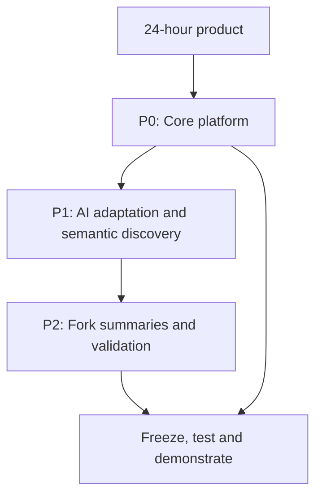
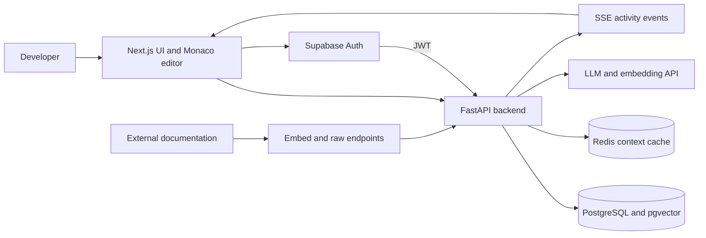
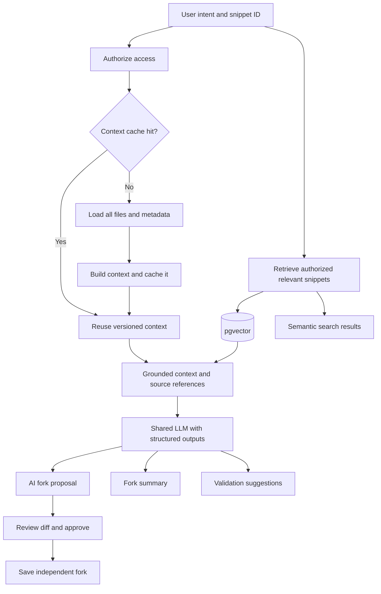
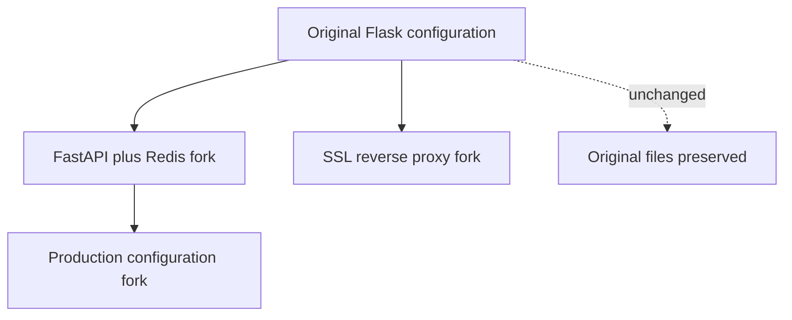
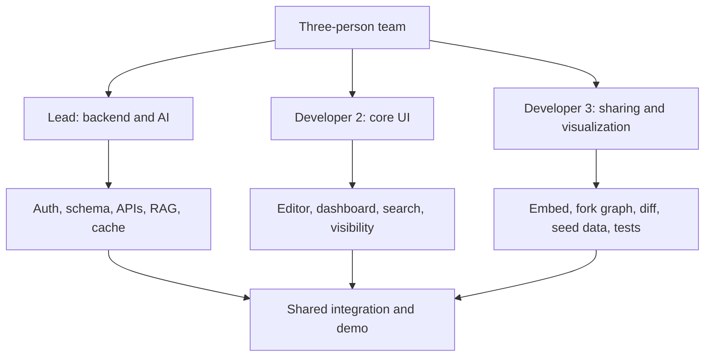
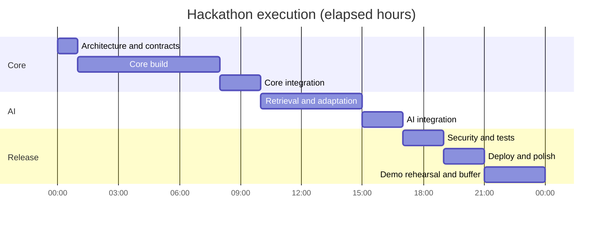
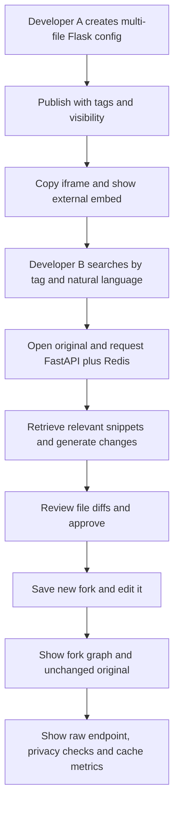

# AVISHKAR ’26 — Ascent B | Hackathon execution plan

**Problem 35:** Code Snippet & Gist Sharing Hub with Forking & Embeds  
**Team:** Ascent B · 3 developers · 24 hours  
**Product positioning:** Intelligent code reuse, not merely code sharing.

## 1. Objective and winning strategy

Build a fully functional multi-file snippet platform that meets every mandatory requirement, then differentiate it with context-aware AI forking. Use one intelligence layer rather than six unrelated AI features. The AI should help developers discover and adapt configurations, not merely explain code in a chatbot.

**Priority:** P0 = mandatory; P1 = competitive differentiators; P2 = stretch. Allocate roughly 55% of effort to core, 25% to AI and 20% to reliability/demo. These are planning targets, not measured estimates. If core is not integrated by hour 10, pause AI expansion.

### Product priorities

[Open editable diagram in Mermaid Live](https://mermaid.live/edit#pako:eNpFj8FqwzAMhl9F6JzAVnbyYdAmLewW2G5ZD8JWVtPYDrLc0ZW--xrvsKv-79Mv3dAmx2hwmtO3PZEofPSfEbbj5qU9pSKwSHLF6hHa9hV2IwxPBrokDMtMOiUJcHzwuxp34_BsYPsG5GhRUp8iUHSQOVBUb8H5bNOF5bo6XXX6cdgYOCQ5Qy4hkHjOVbrQ7F3dscJ9hffjQZh_uAHlrBVzHFLMKqT8f8geGwwsgbxDc0M9cVifdDxRmRXvDVLR9H6NFo1K4QbL8uji3tOXUPgb3n8BFkRfAQ) · [Mermaid AI](https://mermaid.ai/mermaid-ai/)

## 2. Requirements and acceptance checklist

| Priority | Requirement | Proof for judges |
| --- | --- | --- |
| P0 | Responsive frontend, state and client validation | Create/edit a snippet on desktop and mobile-width screen; reject missing filename |
| P0 | Multi-file snippets, automatic language detection and syntax highlighting | Create Dockerfile, compose YAML and Python files in one snippet |
| P0 | Authentication, authorization and RBAC | Sign in as two accounts; enforce owner edits and private reads at API level |
| P0 | Public, unlisted and private visibility | Public searchable; unlisted link-only; private denied to unrelated user |
| P0 | One-click fork and edit | Fork creates independent copy and parent relationship; original unchanged |
| P0 | Fork graph | Show parent and child nodes for accessible snippets |
| P0 | Embeddable widget | Copy iframe and display it in separate demo documentation page |
| P0 | Raw endpoints | Return plain text, UTF-8 and nosniff; HTML code does not execute |
| P0 | Tags, stars, full-text search | Find by tag and content; star/unstar persists |
| P0 | Persistence and real-time | Reload retains data; SSE updates visible fork/star activity |
| P0 | Server-side validation and structured errors | Invalid request returns consistent error; unauthorized request denied |
| P0 | Environment secrets and runnable deployment | No keys in repository; working hosted URL or Docker Compose |
| P0 | Seed data | Seed realistic example configurations with no real secrets |
| P1 | Semantic discovery + RAG | Natural-language search retrieves relevant, accessible snippets with references |
| P1 | Context caching | Repeat query reuses unchanged processed context; edit invalidates it |
| P1 | AI-assisted multi-file fork and diff | Adapt configuration, review changes, save independent fork |
| P2 | Fork summaries | Summarize actual diff, label as AI-generated |
| P2 | Cross-file validation | Deterministic checks and AI suggestions; no unsupported production-ready guarantee |
| P2 | AI metrics | Record actual cache hit/miss, retrieval and latency |

## 3. Architecture and technology

| Component | Proposed choice |
| --- | --- |
| Frontend | Next.js, Tailwind CSS, shadcn/ui |
| Editor and highlighting | Monaco Editor; infer language from filename, with content fallback |
| Backend | FastAPI, REST APIs, SSE for activity |
| Authentication | Supabase Auth; verify JWT in backend |
| Persistence and search | PostgreSQL full-text search + pgvector |
| Cache | Redis |
| AI | One LLM provider and embeddings API |
| Fork graph | React Flow |
| Deployment | Vercel + hosted backend, or local Docker Compose as fallback |

The stack is a recommendation, not a constraint from the brief. Avoid microservices, complex agents and orchestration frameworks. Confirm provider credentials and database extensions in hour 1.

### System architecture

[Open editable diagram in Mermaid Live](https://mermaid.live/edit#pako:eNpNkN1uwjAMhV_FyhWTYA_Qi0mVKBJTmRhdxUXGhUlMm61NqtTlR8C7L22njbs457OPj69COU0iEofKnVSJniHdfFrI5ZyOVLmG_A5msxdYyDc68_NXC_kS0GpYOYvKAWnDzu9Cy2LgYrnAluP1EvaovsnqBymXWdfgHluCuOOyV-K8l26v248bxH09kGs5WbuWC0_Zezq4NcWRVDB62v1BGznZBPcWlLMcdgOFqqQHIJVpuhq6qd6T1sYWEBb7BzKZZQmgYnM0fIEQ2HLby9kYOby2MjkzeYsVaKe6OhDIxtnxKIlM-smDh8cThLiNM79DkjG0mIqafI1Gi-gquKS6P7emA3YVi_tUYMcuu1glIvYdTUXXaGSaGyw81uPn_Qc_W4qK) · [Mermaid AI](https://mermaid.ai/mermaid-ai/)

### Minimal data model

- Users: id, role, display name.
- Snippets: id, owner_id, title, description, visibility, parent_id, version, timestamps.
- Files: id, snippet_id, filename, language, content.
- Tags and snippet_tags: normalized categories.
- Stars: user_id, snippet_id (unique pair).
- Embeddings: snippet_id, version, vector; optional per-file vectors later.

### Minimal API contract

| Method | Route | Purpose |
| --- | --- | --- |
| POST | /snippets | Create multi-file snippet |
| GET / PATCH | /snippets/:id | Read or update authorized snippet |
| POST | /snippets/:id/fork | Copy files, record parent, assign new owner |
| GET | /snippets/:id/graph | Accessible fork lineage |
| GET | /snippets/:id/raw/:fileId | Plain-text file |
| GET | /embed/:id | Read-only escaped code widget |
| GET | /search?q=&tag= | Full-text and tag search |
| POST / DELETE | /snippets/:id/star | Add or remove star |
| GET | /events | Authorized real-time activity stream |
| POST | /ai/search | Semantic retrieval |
| POST | /ai/adapt | Generate proposed multi-file changes |
| POST | /ai/summarize or /ai/validate | Optional stretch endpoints |

Access checks apply to every route, including raw, embed, graph, search, RAG and events. Index only public snippets in the shared discovery corpus. For a private current snippet, send content to the model only with authorization and explicit user action; no private content in public embeddings. Unlisted items must not be globally discoverable. Default forks to private or allow explicit visibility selection.

## 4. One shared AI engine, six capabilities

| Capability | Implementation | Target effort after core |
| --- | --- | --- |
| Context caching | Redis key includes snippet/version, user or access scope, model and prompt version as appropriate; recheck permissions | 30–60 min |
| RAG | Embed public sample snippets; retrieve top relevant results | 1–2 h |
| Semantic search | Similarity retrieval with snippet references | 1 h |
| AI forking | Structured proposed files; diff and approval before save | 2 h |
| Intelligent fork analysis | Summarize deterministic diff | 1 h (stretch) |
| Cross-file validator | Check ports/service names and missing variables for demo config | 1–2 h (stretch) |

Estimates are optimistic and overlap; debugging and integration need buffer. Redis caching reuses processed context, not necessarily provider-side token caching. Track cache hit rate separately from LLM latency. Validate model output as untrusted data; never execute generated code automatically.

### Shared AI engine

[Open editable diagram in Mermaid Live](https://mermaid.live/edit#pako:eNpVUslu2zAQ_ZUBTw3g_IAPDWwLcQIoRWKlhgvWhwE5sohKosBFTmr73zuksvUiDGbe41ugk1BWk5iLurVH1aAL8Fz87uFJ_vTkwPSB-gDYa_C9GQYKcF_s4fr6OyzkIobGOvOXAJUi7_fMW-Tb6rSyzHwJoFA1BI0JNxe-rtL1_Iv8GXZyQ9ETjOS8sT1pUBNl_4H7Yc_wKEuLGrBtoTYt-Wylo4AaAyboYxa8k8to2o83MmqSNvnBu4zapWB52rB6cIZG9v6eQoOjlkbkvG9Zc6JNJmzlt-EwkgrWXaXtNm_Xcu1s7DX9r-xtdIr4uZoc9VxNYuwmBk_rPJWy4rqZWZYPcDShAR9cVCGmnY1hiJN-mdFLubiH2ro_MDg7WI_t562St-ngY9ehe_3cP8sttoaL4n75ejiQT-OXVA-yoo4DGwWe0KmGPfvYTsLLDCm4qdHQEbSp65wOB7YwUoIUGXIrK-QiDfcwEH-4wOR0L2aiI9eh0WJ-EqGhLv1ommpkCXGZCa7eVq-9EnNOTjMRBzZLhcGDw25aXv4BPevk-Q) · [Mermaid AI](https://mermaid.ai/mermaid-ai/)

### Flagship feature — context-aware AI forking

A developer discovers a Flask configuration and asks: “Adapt it for FastAPI and Redis.” The engine loads all authorized files, retrieves relevant public examples, produces coordinated proposed edits, and returns a diff. The developer approves and creates a new fork using the existing fork endpoint. The original is preserved. If AI fails, manual fork remains available.

### Fork lineage

[Open editable diagram in Mermaid Live](https://mermaid.live/edit#pako:eNpVj9GKwjAQRX9lmOfqB_RhQa2CsKBs963bhyGZ1GCalEmiK-K_27qw6uvlzJl7r6iCZizRuHBWB5IE39WPh0WzE9tZTw42juIRVPDGdlko2eBbmM0-YNlsKKbFfguDyxG-WNsIJsixnQQPZNXU9ScIn1giwyDh9_JPLB9E1ewl6Kwm7fuTV9Ucsh_b-Y41zMer9bOesY7jqObIcmLdYoE9S09WY3nFdOB-mqfZUHYJbwVSTqG-eIVlkswF5kFT4spSJ9T_hbc7X3xgrw) · [Mermaid AI](https://mermaid.ai/mermaid-ai/)

## 5. Team allocation

| Owner | Owns | Independent decisions |
| --- | --- | --- |
| Lead | Schema, auth, API, access policy, AI engine and integration | Backend contracts, core feature cutoff and release readiness |
| Developer 2 | Dashboard, editor, snippet viewer, search, visibility | Frontend components and layout within agreed contracts |
| Developer 3 | Embed, fork graph, diff viewer, seed data, tests | Visualization, demo fixtures and QA execution |

Freeze route shapes and example JSON responses early. Juniors should use agreed fixtures while the backend is being built. Flag a blocker after 15 minutes without progress. If frontend integration is beyond either teammate’s ability, simplify the UI and move them to fixtures, testing and demo preparation rather than adding more work to the lead.

### Team ownership

[Open editable diagram in Mermaid Live](https://mermaid.live/edit#pako:eNpNkDFvwjAQhf_KybMZaLcMlQJUFVKHqtApZbjYF2IR28i-UFHEf-85YehgyfJ73713vikTLalKdUP8MT0mhv3mO8C-2feJaHGmlGMAJvQHWCxeoG7eCW0FLZoTBQsop94eCjLpq2ZDFxqigPBUgYmJ4Oufvv6nP1eQJdKF4zTm4vKIg_tFdjEUop4Tl009cq8hm548aqg_tlnDZ_2mwaC8FetqDl82r9ZxTBos5r6NmKxwhMkIL_Nd6wbH10Ks5zpC-JbE1cV0gmPCszit67rCkZU5LJFMmfNUaTlh22YnxUV2gUmg0njawZKPU5-HrwQ9rkorT8mjs6q6KZZdyr9b6nAcWN21wpHj7hqMqjiNpNV4lnDaOJQAPz_e_wBGBox7) · [Mermaid AI](https://mermaid.ai/mermaid-ai/)

## 6. 24-hour execution schedule

| Elapsed | Owner | Task | Visible outcome |
| --- | --- | --- | --- |
| 0–15 min | All | Agree story, P0/P1/P2 and responsibilities | Scope and demo script |
| 15–30 min | Lead + team | Schema, endpoints and response fixtures | Shared API contract |
| 30–60 min | All | Repos, environment, keys and deployment smoke test | Running skeleton |
| 1–5 h | Lead + Dev 2 | Auth, create/view, file editor and visibility | Two users can create and read permitted snippets |
| 1–5 h | Dev 3 | Seed, embed, graph UI against fixture | Share UI ready |
| 5–8 h | All | Fork, raw, search, tags, stars, SSE | Core functions working |
| 8–10 h | All | Integrate and test official workflow | P0 flow end to end |
| 10–12 h | Lead | Embeddings, retrieval and Redis | Real sources and cache hit |
| 10–12 h | Dev 2 + 3 | AI search UI and diff review | UI connected to fixtures/API |
| 12–15 h | All | Context-aware adaptation and save fork | Flagship demo working |
| 15–17 h | All | P1 integration; P2 only if time permits | Integrated AI workflow |
| 17–19 h | All | Security, error paths and regression | Acceptance checklist verified |
| 19–21 h | Lead + team | Deploy, polish, freeze | Working URL and local fallback |
| 21–24 h | All | Rehearse, fix only blockers, submit | Confident repeatable demonstration |

**Cutoff:** hour 10 core gate; hour 15 AI gate; hour 21 feature freeze. Plan for fatigue and short rotating breaks. The timeline diagram uses a synthetic midnight start to represent elapsed hours, not an actual event schedule.

### 24-hour timeline

[Open editable diagram in Mermaid Live](https://mermaid.live/edit#pako:eNpdkcFqAjEQhl9lCAgtrLBaSiE3qRQ9eNFTwcuYzJrQ3c2STIoivntndVfahhySme__MzO5KBMsKa2O2DLvW2DPNcEKzReyCy3QiUxmL6cnqrFLZMGFHNOzsBaZPkJskOFT1nSzmS6XsFrpppEsnnwaspOVnmwklMjcrN5DJLkuonGeJZYjAbYWTGg5ouEEGguYl2U5LWeyoSx1WRYwc_u7GA7Z1xb0oQCsmCII_vZI-pbpGPH2lDYjIuzc_SpisZbLljh6-sb69j5a7HjQ2VEnBq-9brH-a0wjYP8Zb6kmTH2DO5ld9Hy-mTOlvrFqlNEgW1JXhzvShdonB_o4MtWDaQJEcoQxDbUeclUJod3IiujFqUI1JDP3VumLYkdN_7mWKsw1q2uhMHPYnVujNMdMhcpd_4tLj9JXcw9efwAJP7OO) · [Mermaid AI](https://mermaid.ai/mermaid-ai/)

## 7. Demonstration story (3–5 minutes)

1. Developer A creates a multi-file Flask configuration and publishes it with tags.
2. Copy its iframe code and display it in a separate documentation page.
3. Developer B searches by tag, then searches by engineering intent using semantic discovery.
4. Ask AI to adapt the configuration to FastAPI and Redis. Show retrieved source snippets.
5. Review the multi-file diff and approve the new fork. Edit a file in the fork.
6. Show the fork graph and unchanged original; optionally show AI summary.
7. Show privacy denial for a private snippet, raw endpoint headers and a repeat request with cache evidence.

If the AI provider is down, demonstrate manual forking and disclose the outage rather than presenting a precomputed result as live.

### Demo workflow

[Open editable diagram in Mermaid Live](https://mermaid.live/edit#pako:eNpNkkGO2zAMRa9CaJ1cIIsCSTyZSTcdTLpzs2Ak2iYiS6pEOQ0Gc_dKMlB0aeM98vPbn0p7Q2qnBusfesIo8LP75WDfd7SQ9YEi7EFHQqEEc7bC24EtwcliuoP2buDxCtvtNzj07_lmOU3wYJlAcEyAzsDCiW9sWZ7XMvjQ2GN_9OEJPEScqVFp8g-gP0LRoQWab2Qqfmx491-aAyTCqKcS5_asW5ruUHIsokU3Zhypul1zX_ofgRz4yCPX0ZWO9DtTEjhhkv37GYLNCT7IcKreS_NO_QdJ5LK34JYWdALJcQgk610jOYqlFii1uZGaemrqa1EXpge0pgwPw2pgCNEvLdtrA9_6C5b5rqI-3htUUgiwVOitQef-UrtpwBgxTA3Lbl1r_l1WjXMzvq9GxNKoM8Gzkw2EyAvqZ0lL-r7m0VgeYK5n6nRVGzVTnJGN2n0qmWiu_4WhActXV18bhVn85em02knMtFE5mHJ-x1hSzevLr7-v_8zq) · [Mermaid AI](https://mermaid.ai/mermaid-ai/)

## 8. Release checklist

- [ ] All P0 acceptance tests pass.
- [ ] Owner and unrelated user permissions tested for all surfaces.
- [ ] Raw response includes `Content-Type: text/plain; charset=utf-8` and `X-Content-Type-Options: nosniff`.
- [ ] Embed renders escaped code, not executable user HTML.
- [ ] Server validates input and returns structured errors; no secrets committed.
- [ ] Data persists and real-time activity works.
- [ ] Official create → embed → fork/edit → tag search workflow tested.
- [ ] Semantic search and AI fork work with actual retrieval and reviewed diffs.
- [ ] Cache invalidation tested after content/visibility change; cache metrics measured, not invented.
- [ ] Hosted deployment or Docker Compose tested on a clean setup.
- [ ] Demo rehearsed with two accounts and seed data; backup ready.

## 9. Judge positioning

**GitHub Gist helps developers share code. Our platform helps developers discover, understand and adapt multi-file configurations using context-aware AI while preserving their origin.**

Do not claim that Gist lacks ordinary sharing, multi-file support or forking. Demonstrate the actual differentiators: explicit private access, structured discovery, visual fork lineage and AI-assisted adaptation. Only present features that are implemented and tested.

## 10. Assumptions and risks

- Three-person team; junior developers' independent frontend abilities remain unverified.
- The brief does not define the real-time event or detailed role matrix. This plan chooses activity events and owner/other-user permissions with a user role model.
- No AI provider, deployment target, or API budget is confirmed. Test credentials and fallback early.
- Fork summaries and validation are stretch goals, not guaranteed deliverables.
- Generated Mermaid diagrams are editable Live Editor links, not saved collaborative Mermaid AI projects. Each diagram includes its source so it can be pasted into Mermaid AI or a Notion Mermaid code block. Links are generated locally; online rendering has not been browser-tested.
